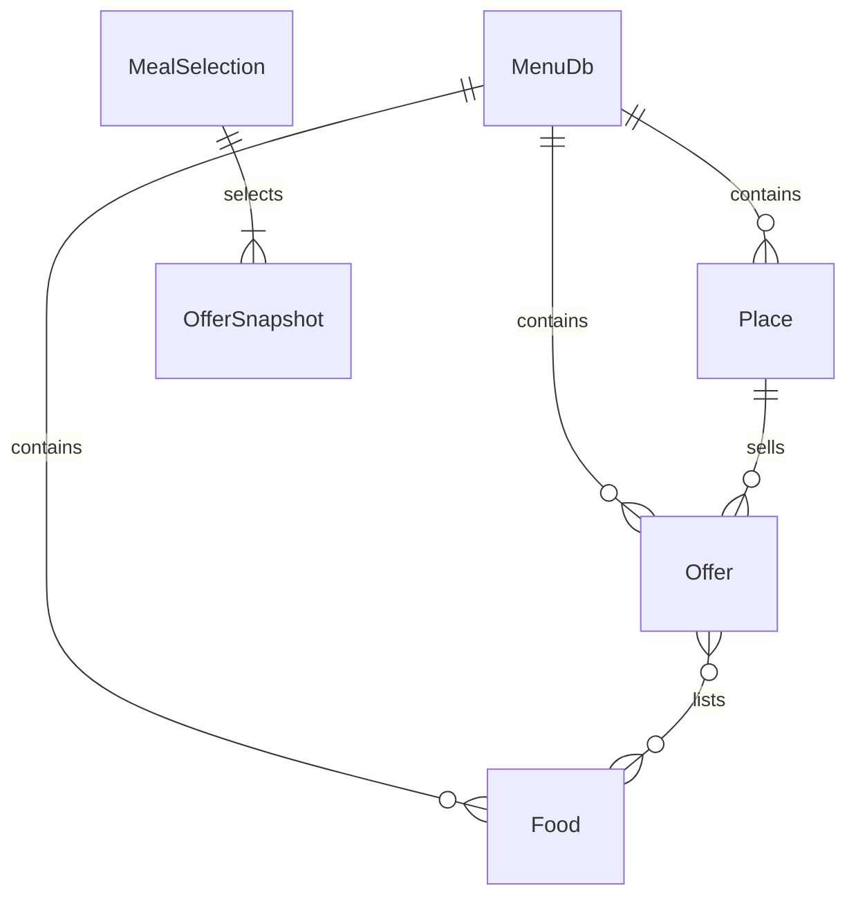

> 最新为 v0.5：[简化选餐-v0.5.md](简化选餐-v0.5.md)。下文为历史记录。

> 当前版本为 v0.4，最新行为和验证边界见 [真实菜单接入-v0.4.md](真实菜单接入-v0.4.md)。以下为历史设计/验证，冲突处以 v0.4 文档为准。

# 吃什么 · 中北大学选餐框架

## 1. 已确认的产品边界

面向中北大学校内餐厅与周边小饭店。用户购买成品菜，预算按具体店铺、具体份量的售价计算。一顿饭默认三个组成项，不是三个完整套餐。用户可以使用团队维护的官方菜单库、自己的个人菜单库，或同时使用两者。

本轮完成本地优先的原型框架：双库、关联菜单、组合推荐、局部锁定重抽、个人录入和 JSON 迁移。内置的是 **2 家虚构店铺、16 个示例售卖项、9 种食材**。所有示例价格均不代表中北大学实际价格。没有接入外卖、地图、校园认证或在线商家系统。

## 2. 交互

### 搭一顿

输入本顿预算 → 选择官方 / 个人 / 合并库 → 默认同店购买 → 可选排除食材 → 生成三个组成项。

每张卡片显示菜名、店铺、份量、标价、来源及示例标记。点击卡片查看配料、价格记录时间和在售标记；点击锁定图标保留此项。底部显示三项标价合计，“只换未锁定项”保持锁定位置和完整内容。

| 情况 | 应用行为 |
|---|---|
| 两项锁定 | 剩余预算 = 总预算 − 两项锁定价格；只替换第三项 |
| 三项锁定 | 不重抽，提示先解除一项锁定 |
| 预算低于锁定项合计 | 提示提高预算或解除锁定，保留原结果 |
| 换库后找不到锁定项 | 明确提示来源冲突，不自动解锁 |
| 导入新菜单导致锁定项改价 / 下架 | 阻止继续使用旧快照，请用户处理 |
| 没有其他可行组合 | 保留原结果，解释可调整的条件 |
| 大菜单搜索达到上限 | 区分“未搜索到”和“确定无解” |

原型固定为一人一顿、三项各一份，份量以菜单文字为准。后续再支持人数、数量、二至五项，以及主食可选等模板。当前要求三项合计覆盖主食、蛋白质类和蔬菜；这只是组合规则，不是营养充分性结论。

### 菜肴食材

共享库筛选器；可按菜名、店铺名、食材搜索（输入后回车 / 完成）。菜品详情显示关联食材，点击食材反查菜品；食材索引也可直接反查。配料未知保持未知；启用食材排除时不推荐配料未知的菜品。实际调味、交叉接触需向商家核实。

### 菜单库

- 官方库：随包提供只读示例，可手动导入更高版本的数据包；用户不在表单里直接修改它。
- 个人库：新增 / 编辑 / 删除菜品，修改价格、份量、分类、主要配料、在售状态和店铺信息。
- 两个库均可导出 JSON、复制保存为 UTF-8 文件；个人库支持导入替换。
- 导入流程：粘贴 → 校验 → 查看版本与条目数 → 明确确认替换 → 保存。
- 更新任一库不会覆盖另一库。当前“官方”是来源分类，不是密码学真实性保证；远程自动更新和签名认证属于后续阶段。

Windows ≥850 逻辑像素使用左侧导航，较窄窗口及 Android 使用底部导航。正文最大宽度 850，表单、卡片与弹窗支持滚动。

## 3. 数据模型

| 对象 | 字段与含义 |
|---|---|
| MenuDb | schemaVersion、source、revision、places、foods、offers |
| Place | id、name、area；代表一个售卖店铺 / 窗口 |
| Food | id、name；用于食材关联和排除 |
| Offer | id、placeId、name、portion、priceCents、roles、foodIds、updatedAt、available、ingredientsKnown、example |
| Entry | 数据库来源 + 售卖项；全局键为 source:id，防止跨库 ID 冲突 |
| MealRequest | budget、samePlace、excludedFoods、previous、locked |
| MealResult | meal、message、limited；无结果不修改旧选择 |

这里的 Offer 是“某店某份量某价格的菜”，并不是独立于店铺的抽象菜谱。相同菜名在不同店铺可以有不同售价、份量和配料。一个菜支持多个角色，盖饭等可同时记为主食与蛋白质类。

价格以整数“分”保存，输入最多两位小数。必填、正价格、ID 唯一、外键存在、角色枚举和日期可解析都在保存 / 导入时验证。原型每库限 500 个售卖项、200 个店铺、2000 种食材；导入文本上限 200 万字符。

跨库同名店铺暂不自动认定为同一实体；同店约束使用 source:placeId。这样可能错过部分真实可搭配组合，但不会仅凭同名而把不同店铺混在一起。后续通过团队维护的 campusPlaceId 和用户显式关联支持跨库身份合并，不按名称猜测。合并库不覆盖或去重同名菜品，来源保持可见。

个人库当前以设备本地 SharedPreferences 中的单份 JSON 文档保存；先验证、保存成功后再替换内存状态。适合小规模原型，不承诺数据库事务级崩溃持久性。加载损坏数据时显示错误，不自动覆盖。扩展阶段通过仓储接口换 SQLite，并提供导入预览、自动备份、回滚和迁移版本。

## 4. 推荐算法

1. 选择库范围，过滤下架菜品和超预算单品。
2. 若有食材排除，要求配料已知并无排除食材。
3. 核验锁定快照：同来源同 ID、内容未改变、符合新条件。
4. 先扣除锁定金额，固定锁定索引；若锁定项冲突立即说明原因。
5. 对未锁定位置搜索候选；加入每项时检查不重复、剩余预算、同店条件。
6. 完整三项必须覆盖三种角色；排除与上一轮完全相同的集合，避免只是换位置。
7. 对可行组合做加权随机：食材种类多、店铺数量少的组合权重较高。
8. 结果写入当前选择；没有结果则保留原选择。

权重：`1 + 0.15 × 食材种类数 + 0.8 × (3 − 店铺数)`；使用 `U^(1/weight)` 的随机优先级保留最高者。预算是硬约束，不以“尽量花完钱”为优化目标。此阶段尚未做口味标签、距离、排队时间、烹饪方式重复惩罚或历史学习。

搜索最多访问 250,000 个节点。达到上限且已有解时返回有效解并提示范围有限；无解时不宣称全局不可行。最坏情况约 O(n³)，原生端已使用 Flutter compute 在 isolate 中执行，计算期间避免修改条件。接入数百道菜前仍应改为按店铺与角色索引、去除排列重复和更强分支剪枝，以缩短等待时间。

## 5. 官方库运营与下一阶段接口

当前可落地流程：团队维护 `assets/official.json` 或独立 JSON 数据包 → 修改版本 → 本地校验 → 发布文件 → 用户导入。正式上线前补齐真实店铺核验、价格记录人、采集时间、配料可信度和纠错入口。

后续远端分发建议：

- `GET /v1/campuses/nuc/catalog/manifest`：schemaVersion、revision、publishedAt、downloadUrl、sha256、signature。
- 下载不可变版本包 → 校验签名 / 摘要 / 模型约束 → 在本地暂存 → 提交更新，保留上一个版本供回滚。
- 官方库编辑后台与用户客户端分离；未经审核的用户投稿不直接进入官方菜单。
- 个人库默认本机保存；账号和跨设备同步在明确需求后再做。
- 需记录店铺附加费用 / 起购限制；支持前，界面明确当前合计不含配送、打包等费用。

上述接口、服务器、签名和审核后台是规划，尚未实现或部署。

## 6. 技术与视觉

Flutter + Dart：共享 Windows 与 Android 的界面、模型和算法；仓储层隔离存储实现。已复用此前工程的原生平台模板与构建经验，本轮重新实现组合模型和业务界面，旧工程未改动。

原创视觉：暖米白底、陶土橙碗、三缕蒸汽、面条和微笑弧线。只借用拉面小店的温暖意象，不使用动画人物、招牌文字或动画标志。交付可编辑 SVG、PNG、Windows ICO 与 Android 各密度图标。

## 7. 验收与范围

需要验证：预算永不超出、锁定项不变、确实存在新组合才更新、无解保留原结果、改价锁定项失效、未知配料过滤、双库隔离、导入外键校验、本地持久化、手机与桌面布局。

详见 `验证记录.md`。必须区分已执行的静态检查、已编写但未能运行的 Flutter 测试，以及未覆盖的 GUI / 真机 / 原生构建验证。

## 8. 参考资料

- Flutter 官方平台支持：https://docs.flutter.dev/reference/supported-platforms
- Flutter Windows 桌面集成：https://docs.flutter.dev/platform-integration/desktop
- Flutter Android 环境：https://docs.flutter.dev/platform-integration/android/setup
- 调研候选：https://github.com/shatteredsent/meal-planner-app （仅检索参考，未运行、未引入其代码；现有自有工程更贴合本任务）
